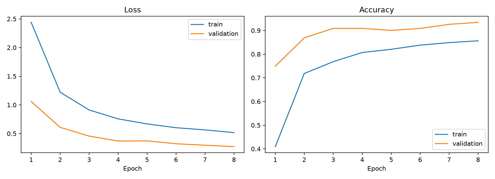
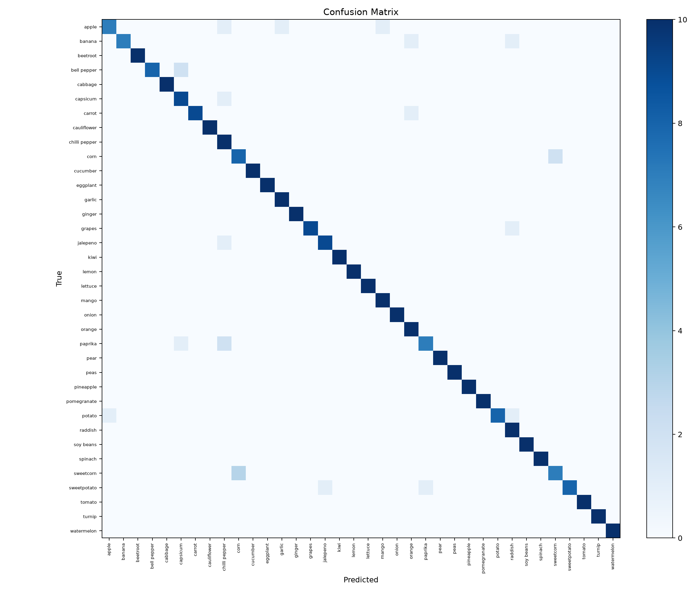
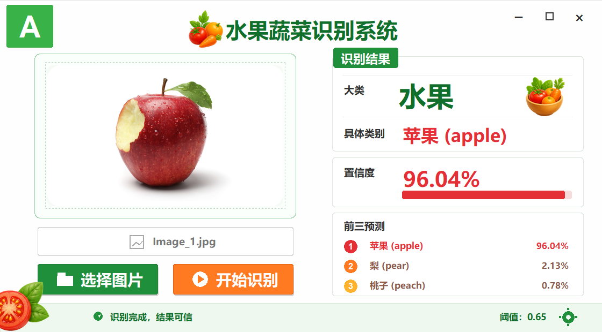

# 水果蔬菜图像分类系统

基于 ResNet18 迁移学习的水果蔬菜图像分类系统。支持 36 个细类识别、水果/蔬菜大类判定、单张图片预测、Tkinter 图形界面交互，以及未知图片的低置信度提示。

测试集 **Top-1 准确率 93.6%**，**Top-3 准确率 98.1%**（36 类，359 张测试图）。

## 效果展示

| 训练曲线 | 混淆矩阵 |
|:---:|:---:|
|  |  |



## 功能特性

- **36 类精细分类**：覆盖苹果、香蕉、胡萝卜等 36 种常见水果与蔬菜
- **大类判定**：在细类基础上额外给出「水果 / 蔬菜」归属
- **迁移学习**：加载 ImageNet 预训练 ResNet18，冻结主干卷积层，仅训练分类头（512 → 36）
- **数据增强**：随机裁剪、水平翻转、颜色扰动，缓解小数据集过拟合
- **低置信度提示**：最高概率低于阈值（默认 0.65）时提示「图片可能不属于已知类别」，避免对未知图片强行归类
- **双入口**：命令行脚本 `predict.py` 与 Tkinter 图形界面 `gui.py`
- **训练可视化**：自动产出训练曲线、混淆矩阵、分类报告与指标 JSON

## 项目结构

```text
.
├── assets/                            # GUI 界面素材图片
├── models/                            # 模型保存目录（权重不纳入版本控制）
├── results/                           # 训练结果输出
│   ├── resnet18_training_curve.png        # 训练曲线
│   ├── resnet18_confusion_matrix.png      # 混淆矩阵热力图
│   ├── resnet18_confusion_matrix.csv      # 混淆矩阵数据
│   ├── resnet18_classification_report.txt # 分类报告
│   └── resnet18_metrics.json              # 评价指标
├── train.py                           # 模型训练脚本
├── predict.py                         # 单张图片预测脚本
├── gui.py                             # Tkinter 图形界面
├── utils.py                           # 工具函数（路径、数据集校验、类别映射）
├── requirements.txt                   # 依赖库列表
└── README.md
```

## 环境安装

```bash
pip install -r requirements.txt --upgrade
```

依赖说明：

| 库 | 用途 |
|---|---|
| `torch` | PyTorch 深度学习框架 |
| `torchvision` | ResNet18 预训练模型与数据变换 |
| `Pillow` | 图像读取与预处理 |
| `matplotlib` | 训练曲线与混淆矩阵绘制 |
| `scikit-learn` | 分类报告与混淆矩阵计算 |

安装 PyTorch 时若网络较慢，可按 [PyTorch 官网](https://pytorch.org/) 给出的命令选择合适版本（CPU / CUDA）。

## 数据集准备

本项目使用的 36 类水果蔬菜数据集（约 3800 张图片、2.1 GB）**因体积过大未纳入版本控制**，需自行准备。

将其按以下结构放置（目录名即类别名，需与下方类别表中的英文一致）：

```text
frutable/
├── train/
│   ├── apple/
│   ├── banana/
│   └── ...
├── validation/
│   └── ...
└── test/
    └── ...
```

程序通过 `torchvision.datasets.ImageFolder` 按目录名自动推断类别标签，因此**子目录名称必须完全匹配**。

数据集放在其他位置时，训练时用 `--data-dir` 指定：

```bash
python train.py --data-dir /path/to/your/frutable
```

## 训练模型

模型权重未随仓库提供，首次使用需自行训练生成（`models/` 为空）：

```bash
python train.py --model resnet18 --epochs 8
```

训练流程：

1. 读取 `frutable/train`、`frutable/validation`、`frutable/test` 三个划分
2. 训练集施加数据增强，验证集与测试集仅做固定预处理
3. 加载 ImageNet 预训练 ResNet18，冻结主干，仅训练最后的全连接分类层
4. 每轮在验证集上评估，保留验证集准确率最高的权重至 `models/best_resnet18.pth`
5. 训练结束后自动生成训练曲线、混淆矩阵、分类报告与指标 JSON 到 `results/`

首次运行会自动下载 ImageNet 预训练权重；离线环境可加 `--no-pretrained` 从头训练（效果会明显下降）。

常用参数：

| 参数 | 说明 | 默认值 |
|---|---|---|
| `--epochs` | 训练轮数 | 8 |
| `--batch-size` | 批大小 | 32 |
| `--lr` | 学习率 | 0.001 |
| `--image-size` | 输入尺寸 | 224 |
| `--unfreeze-backbone` | 解冻主干，全量微调 | 关闭 |
| `--confidence-threshold` | 低置信度阈值 | 0.65 |

## 单张图片预测

```bash
python predict.py --image path/to/your_image.jpg --model-path models/best_resnet18.pth
```

输出大类（水果 / 蔬菜）、具体类别（中英文）、置信度、Top-K 结果，以及是否触发低置信度提示。

```bash
# 调整低置信度阈值
python predict.py --image your_image.jpg --threshold 0.70
```

## 图形界面

```bash
python gui.py --model-path models/best_resnet18.pth
```

使用方式：

1. 点击「选择图片」，选择一张水果或蔬菜图片（支持 JPG / PNG / BMP / WEBP）
2. 点击「开始识别」，等待推理完成
3. 右侧面板显示大类、具体类别、置信度与前三预测
4. 置信度低于阈值时，底部状态栏提示「低置信度：图片可能不属于已知水果/蔬菜类别」

界面可选参数：`--threshold 0.70` 覆盖阈值、`--top-k 5` 显示前 5 个预测、`--device cpu` 强制 CPU 推理。

## 方法说明

### 模型架构

采用 ResNet18 作为主分类模型。ResNet 通过残差连接（skip connection）缓解深层网络的梯度消失与退化问题。ResNet18 共 18 层，包含 1 个初始卷积层、4 组残差块和 1 个全连接分类层。

### 迁移学习

使用 ImageNet 预训练权重初始化主干，冻结全部卷积层，仅替换并训练最后的全连接层（512 维 → 36 类）。预训练模型已学到边缘、纹理、形状等通用视觉特征，因此在数千张量级的小数据集上也能取得较好效果，且训练成本低。

### 数据增强

训练集使用以下策略，验证集与测试集不做随机增强以保证评估稳定：

- `RandomResizedCrop`：随机裁剪 224×224 区域
- `RandomHorizontalFlip`：50% 概率水平翻转
- `ColorJitter`：亮度、对比度、饱和度扰动（±0.2）

### 低置信度拒识

对不在 36 类范围内的图片，采用置信度阈值机制而非强行分类：

- 最高预测概率 ≥ 阈值 → 输出结果，提示结果可信
- 最高预测概率 < 阈值 → 提示图片可能不属于已知类别

默认阈值 0.65，可通过 `--threshold` 调整。

## 实验结果

| 指标 | 数值 |
|---|---|
| 验证集最佳准确率 | 93.45% |
| 测试集 Top-1 准确率 | 93.59% |
| 测试集 Top-3 准确率 | 98.05% |
| 测试集宏平均 F1 | 0.94 |
| 测试样本数 | 359（36 类 × 约 10 张） |

完整逐类指标见 `results/resnet18_classification_report.txt`，混淆矩阵见 `results/resnet18_confusion_matrix.png`。

## 36 个类别

| 序号 | 英文名称 | 中文名称 | 大类 | 序号 | 英文名称 | 中文名称 | 大类 |
|---:|---|---|---|---:|---|---|---|
| 1 | apple | 苹果 | 水果 | 19 | lettuce | 生菜 | 蔬菜 |
| 2 | banana | 香蕉 | 水果 | 20 | mango | 芒果 | 水果 |
| 3 | beetroot | 甜菜根 | 蔬菜 | 21 | onion | 洋葱 | 蔬菜 |
| 4 | bell pepper | 甜椒 | 蔬菜 | 22 | orange | 橙子 | 水果 |
| 5 | cabbage | 卷心菜 | 蔬菜 | 23 | paprika | 辣椒粉 | 蔬菜 |
| 6 | capsicum | 辣椒 | 蔬菜 | 24 | pear | 梨 | 水果 |
| 7 | carrot | 胡萝卜 | 蔬菜 | 25 | peas | 豌豆 | 蔬菜 |
| 8 | cauliflower | 花椰菜 | 蔬菜 | 26 | pineapple | 菠萝 | 水果 |
| 9 | chilli pepper | 辣椒 | 蔬菜 | 27 | pomegranate | 石榴 | 水果 |
| 10 | corn | 玉米 | 蔬菜 | 28 | potato | 马铃薯 | 蔬菜 |
| 11 | cucumber | 黄瓜 | 蔬菜 | 29 | raddish | 萝卜 | 蔬菜 |
| 12 | eggplant | 茄子 | 蔬菜 | 30 | soy beans | 大豆 | 蔬菜 |
| 13 | garlic | 大蒜 | 蔬菜 | 31 | spinach | 菠菜 | 蔬菜 |
| 14 | ginger | 姜 | 蔬菜 | 32 | sweetcorn | 甜玉米 | 蔬菜 |
| 15 | grapes | 葡萄 | 水果 | 33 | sweetpotato | 甘薯 | 蔬菜 |
| 16 | jalepeno | 墨西哥辣椒 | 蔬菜 | 34 | tomato | 番茄 | 蔬菜 |
| 17 | kiwi | 猕猴桃 | 水果 | 35 | turnip | 芜菁 | 蔬菜 |
| 18 | lemon | 柠檬 | 水果 | 36 | watermelon | 西瓜 | 水果 |

## 运行环境

- Python 3.10+
- 训练在 NVIDIA GeForce RTX 3060 Laptop (6 GB) 上完成，`--epochs 8` 可行
- 推理与 GUI 可在纯 CPU 环境运行，单张图片耗时约 0.1 秒
